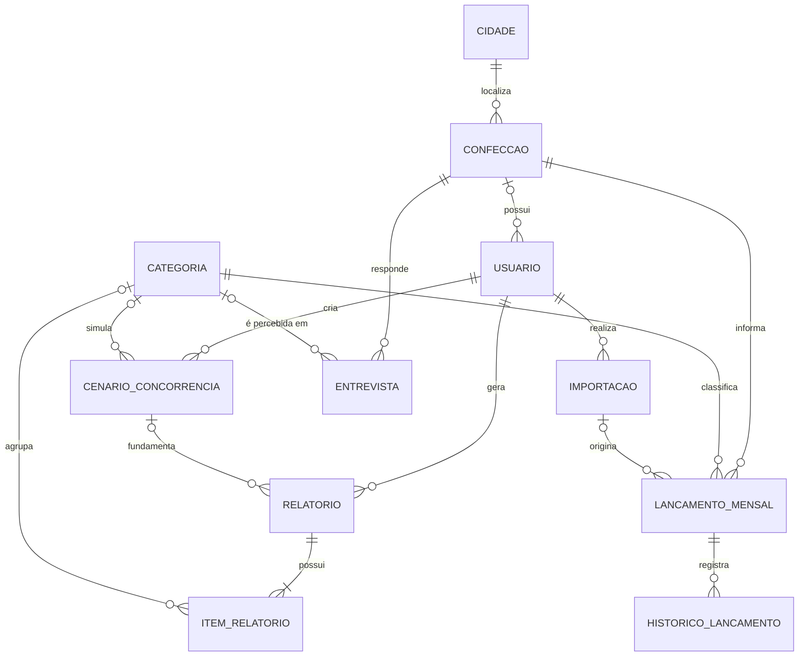
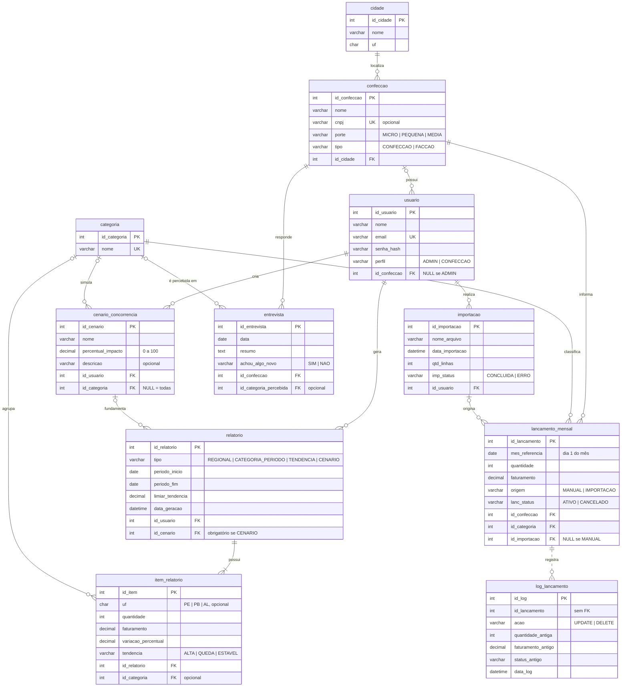

SQL | TRAMA

# Banco de Dados

## Modelo conceitual

No modelo conceitual não aparecem chaves estrangeiras: elas surgem como colunas só no modelo lógico.



### Entidades e atributos

| Entidade | Identificador | Demais atributos |
|---|---|---|
| **Cidade** | id_cidade | nome, uf |
| **Confecção** | id_confeccao | nome, cnpj (opcional), porte (micro, pequena, média), tipo (confecção, facção) |
| **Usuário** | id_usuario | nome, email, senha_hash, perfil (ADMIN, CONFECCAO) |
| **Categoria** | id_categoria | nome |
| **Lançamento mensal** | id_lancamento | mes_referencia, quantidade, faturamento, origem (MANUAL, IMPORTACAO), status (ATIVO, CANCELADO) |
| **Importação** | id_importacao | nome_arquivo, data_importacao, qtd_linhas, status (CONCLUIDA, ERRO) |
| **Cenário de concorrência** | id_cenario | nome, percentual_impacto, descricao (opcional) |
| **Entrevista** | id_entrevista | data, resumo, achou_algo_novo (sim, não) |
| **Relatório** | id_relatorio | tipo (REGIONAL, CATEGORIA_PERIODO, TENDENCIA, CENARIO), periodo_inicio, periodo_fim, limiar_tendencia, data_geracao |
| **Item de relatório** | id_item | uf (opcional), quantidade, faturamento, variacao_percentual, tendencia (ALTA, QUEDA, ESTAVEL) |
| **Histórico de lançamento** | id_log | acao (UPDATE, DELETE), quantidade_antiga, faturamento_antigo, status_antigo, data_log |

## Modelo lógico



`log_lancamento` implementa a entidade Histórico de lançamento e é preenchida pelos triggers. A linha tracejada indica que `id_lancamento` **não é FK**: o registro do histórico precisa continuar existindo depois que o lançamento é excluído, e uma FK impediria isso.

**Legenda da cardinalidade:** `||` = exatamente 1 · `|o` = 0 ou 1 · `o{` = 0 ou N · `|{` = 1 ou N

## Relacionamentos e cardinalidades

| Entidade A | Relacionamento | Entidade B |
|---|---|---|
| Cidade (0,N) | localiza | Confecção (1,1) |
| Confecção (0,N) | possui | Usuário (0,1) |
| Confecção (0,N) | informa | Lançamento mensal (1,1) |
| Categoria (0,N) | classifica | Lançamento mensal (1,1) |
| Importação (0,N) | origina | Lançamento mensal (0,1) |
| Usuário (0,N) | realiza | Importação (1,1) |
| Usuário (0,N) | cria | Cenário de concorrência (1,1) |
| Usuário (0,N) | gera | Relatório (1,1) |
| Categoria (0,N) | simula | Cenário de concorrência (0,1) |
| Cenário de concorrência (0,N) | fundamenta | Relatório (0,1) |
| Relatório (1,N) | possui | Item de relatório (1,1) |
| Categoria (0,N) | agrupa | Item de relatório (0,1) |
| Confecção (0,N) | responde | Entrevista (1,1) |
| Categoria (0,N) | é percebida em | Entrevista (0,1) |
| Lançamento mensal (0,N) | registra | Histórico de lançamento (1,1) |

### Justificativa das cardinalidades opcionais

Cada participação (0,1) do modelo existe por causa de uma regra do [minimundo](docs/minimundo.md):

| Relacionamento | Por que é (0,1) | Regra | Garantia no banco |
|---|---|---|---|
| Confecção → Usuário | O ADMIN não pertence a nenhuma confecção | RN02 | `id_confeccao` aceita NULL; perfil validado pelo sistema |
| Importação → Lançamento mensal | O lançamento pode ser digitado à mão (origem MANUAL) | — | `id_importacao` aceita NULL; `origem` guarda MANUAL ou IMPORTACAO |
| Categoria → Cenário de concorrência | Um cenário sem categoria vale para todas | RN06 | FK aceita NULL |
| Cenário de concorrência → Relatório | Só o relatório do tipo CENARIO usa cenário | RN07 | `id_cenario` aceita NULL; tipo validado pelo sistema |
| Categoria → Item de relatório | O relatório REGIONAL agrupa por UF, não por categoria | RN07 | `id_categoria` aceita NULL; UF ou categoria validado pelo sistema |
| Categoria → Entrevista | O empresário pode não saber ou não responder qual categoria vende mais | RN09 | FK aceita NULL |

**Relatório (1,N) → Item de relatório (RN10):** a exigência de pelo menos um item não pode ser garantida por FK, porque o relatório é gravado antes dos itens. Quem garante é a transação de geração do relatório (`transacoes.sql`): se nenhum item for gerado, ela faz `ROLLBACK`.

## Chaves estrangeiras (modelo lógico)

Em um relacionamento 1:N, a FK fica no lado N. Se a cardinalidade desse lado é (1,1), a FK é `NOT NULL`; se é (0,1), ela aceita `NULL`.

| Tabela (lado N) | FK | Referencia | Obrigatória? |
|---|---|---|---|
| confeccao | id_cidade | cidade | Sim |
| usuario | id_confeccao | confeccao | Não (só para perfil CONFECCAO) |
| lancamento_mensal | id_confeccao | confeccao | Sim |
| lancamento_mensal | id_categoria | categoria | Sim |
| lancamento_mensal | id_importacao | importacao | Não (só para origem IMPORTACAO) |
| importacao | id_usuario | usuario | Sim |
| cenario_concorrencia | id_usuario | usuario | Sim |
| cenario_concorrencia | id_categoria | categoria | Não |
| relatorio | id_usuario | usuario | Sim |
| relatorio | id_cenario | cenario_concorrencia | Não (só para tipo CENARIO) |
| item_relatorio | id_relatorio | relatorio | Sim |
| item_relatorio | id_categoria | categoria | Não |
| entrevista | id_confeccao | confeccao | Sim |
| entrevista | id_categoria_percebida | categoria | Não |

## Regras do minimundo e onde são garantidas

A numeração segue o [minimundo](docs/minimundo.md).

| # | Regra | Implementação |
|---|---|---|
| RN01 | Cada confecção fica em uma única cidade; CNPJ opcional, mas sem repetição | `id_cidade NOT NULL`; `cnpj` aceita NULL e é `UNIQUE` |
| RN02 | ADMIN não tem confecção; CONFECCAO tem exatamente uma | `id_confeccao` opcional; combinação validada pelo sistema |
| RN03 | Um lançamento por confecção, categoria e mês | `UNIQUE (id_confeccao, id_categoria, mes_referencia)` |
| RN04 | Lançamento cancelado fica fora dos indicadores e relatórios | Procedure `cancelar_lancamento` muda o status sem apagar; as consultas filtram `lanc_status = 'ATIVO'` |
| RN05 | Linha inválida na planilha: nada da importação é gravado | Transação em `transacoes.sql` |
| RN06 | Impacto entre 0 e 100; cenário sem categoria vale para todas | `id_categoria` opcional; faixa 0–100 validada pelo sistema |
| RN07 | Relatório CENARIO exige cenário; regionais usam PE, PB ou AL | UF (PE, PB ou AL) e cenário obrigatório validados pelo sistema |
| RN08 | Tendência pela variação comparada ao limiar | Calculada ao gerar o relatório |
| RN09 | Entrevista registra a categoria que o empresário *acha* que mais vende | `id_categoria_percebida` aceita NULL |
| RN10 | Todo relatório tem pelo menos um item | Transação em `transacoes.sql` faz `ROLLBACK` se nenhum item for gerado |
| RN11 | Toda alteração ou exclusão de lançamento fica no histórico | Triggers `trg_log_lancamento_update` e `trg_log_lancamento_delete` |

## Procedures

| Procedure | Parâmetros | O que faz |
|---|---|---|
| `inserir_lancamento` | mês, quantidade, faturamento, confecção, categoria | Grava um lançamento MANUAL e ATIVO; qualquer dia do mês vira dia 1 |
| `atualizar_lancamento` | id do lançamento, quantidade, faturamento | Corrige quantidade e faturamento |
| `cancelar_lancamento` | id do lançamento | Muda o status para CANCELADO, sem apagar (RN04) |
| `excluir_lancamento` | id do lançamento | Apaga o lançamento de vez |

## Triggers

| Trigger | Quando dispara | O que grava em `log_lancamento` |
|---|---|---|
| `trg_log_lancamento_update` | Depois de um UPDATE em `lancamento_mensal` | Ação `UPDATE` e os valores antigos (`OLD`) de quantidade, faturamento e status |
| `trg_log_lancamento_delete` | Depois de um DELETE em `lancamento_mensal` | Ação `DELETE` e os valores do lançamento apagado |

Cancelar um lançamento também gera log, porque o cancelamento é um UPDATE no status.

## Transações

| # | Situação | Resultado |
|---|---|---|
| 1 | Importação de planilha sem erros | `COMMIT`: a importação e as linhas são gravadas juntas |
| 2 | Importação com uma linha inválida | `ROLLBACK`: nada da importação é gravado (RN05); depois só a tentativa é registrada com status ERRO |
| 3 | Geração de relatório com um item digitado errado | `ROLLBACK TO SAVEPOINT`: desfaz só o item errado e mantém os anteriores, depois `COMMIT` |
| 4 | Relatório sem nenhum item | `ROLLBACK`: todo relatório precisa de pelo menos um item (RN10) |

## Consultas

O `consultas.sql` traz 10 consultas que juntam as tabelas com `INNER JOIN` e `LEFT JOIN` e usam `COUNT`, `AVG`, `MAX` e `MIN` com `GROUP BY`. Entre elas:

- confecções com cidade e UF;
- lançamentos ativos por UF e faturamento médio por categoria;
- usuários que nunca fizeram importação (`LEFT JOIN`);
- relatórios com o cenário usado e a quantidade de itens;
- histórico de alterações gravado pelos triggers.

## Arquivos

| Arquivo | Conteúdo |
|---|---|
| [docker-compose.yml](docker-compose.yml) | MySQL 8.0 em container que carrega o `banco_completo.sql` na primeira subida |
| [minimundo.md](docs/minimundo.md) | Minimundo: contexto, usuários, regras de negócio e requisitos |
| [banco_completo.sql](database/banco_completo.sql) | Todos os arquivos abaixo em um único script, na ordem certa; recria o banco do zero |
| [schema.sql](database/schema.sql) | Criação do banco, das 10 tabelas e da tabela de auditoria `log_lancamento` |
| [inserts.sql](database/inserts.sql) | Dados de exemplo para todas as tabelas |
| [procedures.sql](database/procedures.sql) | Procedures para inserir, atualizar, cancelar e excluir lançamentos |
| [triggers.sql](database/triggers.sql) | Triggers que gravam o log de UPDATE e DELETE em lançamentos, com testes |
| [transacoes.sql](database/transacoes.sql) | Transações de importação e de geração de relatório (`COMMIT`, `ROLLBACK`, `SAVEPOINT`) |
| [selects.sql](database/selects.sql) | Consulta de todos os registros de cada tabela |
| [consultas.sql](database/consultas.sql) | Consultas com `INNER JOIN`, `LEFT JOIN`, `GROUP BY`, `COUNT`, `AVG`, `MAX` e `MIN` |

## Como executar

### Com Docker (recomendado para o back-end e o front-end)

Precisa só do [Docker Desktop](https://www.docker.com/products/docker-desktop/) instalado e aberto. Na pasta do repositório:

```bash
docker compose up -d
```

Na primeira vez, o Docker baixa a imagem `mysql:8.0` e roda o `database/banco_completo.sql` automaticamente: cria as tabelas, procedures, triggers, índices e os dados de exemplo. Leva por volta de um minuto. Para saber se terminou:

```bash
docker compose ps
```

Quando a coluna `STATUS` mostrar `healthy`, o banco está pronto. O healthcheck só fica `healthy` depois que a carga inicial terminou e a tabela `lancamento_mensal` responde.

| Configuração | Valor |
|---|---|
| Host | `localhost` |
| Porta | `3307` |
| Banco | `confeccoes` |
| Usuário / senha | `trama` / `trama` |
| Usuário root / senha | `root` / `root` |
| URL JDBC (Spring Boot) | `jdbc:mysql://localhost:3307/confeccoes` |

A porta é `3307`, e não `3306`, para não dar conflito com um MySQL já instalado no computador. Para usar outra porta, defina `MYSQL_PORT` antes de subir (no Git Bash: `MYSQL_PORT=3306 docker compose up -d`). Essas credenciais são só para desenvolvimento.

Para conferir as tabelas e os dados pelo terminal:

```bash
docker compose exec mysql mysql -utrama -ptrama confeccoes -e "SHOW TABLES; SELECT COUNT(*) FROM lancamento_mensal;"
```

Pelo **MySQL Workbench** ou DBeaver, crie uma conexão com os dados da tabela acima.

| Comando | O que faz |
|---|---|
| `docker compose stop` | Para o banco e mantém os dados |
| `docker compose start` | Sobe de novo com os dados que já estavam lá |
| `docker compose logs -f mysql` | Mostra o log do MySQL (útil se o status não ficar `healthy`) |
| `docker compose down -v` | Apaga o container **e os dados**; o próximo `up -d` recarrega o `banco_completo.sql` do zero |

O `banco_completo.sql` só roda quando o volume de dados está vazio. Depois de mudar algum script SQL, use `docker compose down -v` e `docker compose up -d` para recarregar.

A cada push e Pull Request, o GitHub Actions ([`.github/workflows/docker.yml`](.github/workflows/docker.yml)) roda `docker compose up -d`, espera o banco ficar `healthy` e confere que as 11 tabelas existem com dados, além da view, das 4 procedures e dos 2 triggers. O resultado aparece na aba **Actions** do repositório e como ✅ ou ❌ no commit e no Pull Request. Assim, uma mudança nos scripts que quebre a carga inicial é descoberta antes de chegar à `develop`.

### Com MySQL instalado

O jeito mais simples é rodar o script completo, que apaga e recria o banco `confeccoes` com tudo:

```bash
mysql -u root -p < database/banco_completo.sql
```

Se preferir rodar por partes, use os arquivos nesta ordem, porque cada um depende do anterior:

```bash
mysql -u root -p < database/schema.sql
mysql -u root -p < database/inserts.sql
mysql -u root -p < database/procedures.sql
mysql -u root -p < database/triggers.sql
mysql -u root -p < database/transacoes.sql
mysql -u root -p < database/selects.sql
mysql -u root -p < database/consultas.sql
```

Para recomeçar do zero, apague o banco antes com `DROP DATABASE confeccoes;`.

Pelo **MySQL Workbench**: abra cada arquivo em *File → Open SQL Script* e execute (⚡), na mesma ordem.