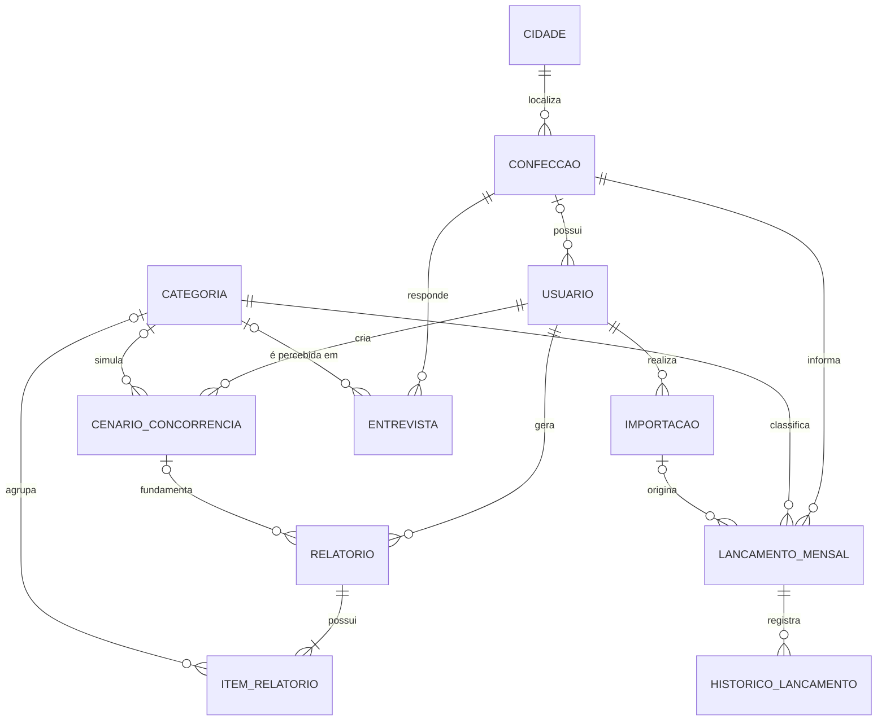
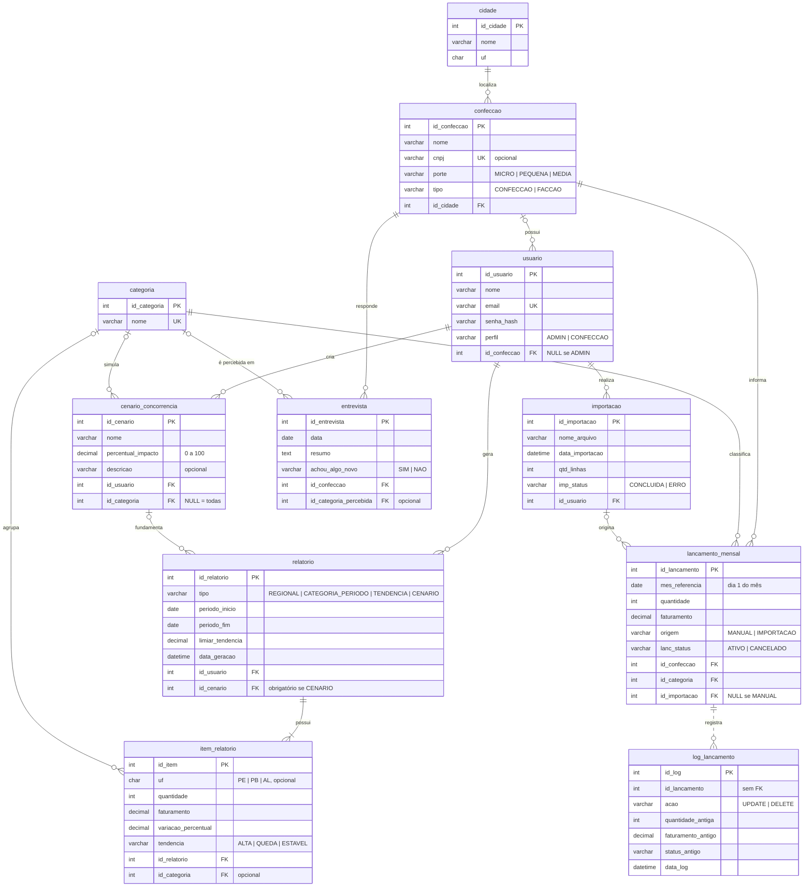

SQL | TRAMA

# Banco de Dados

## Modelo conceitual

No modelo conceitual não aparecem chaves estrangeiras: elas surgem como colunas só no modelo lógico.



### Entidades e atributos

| Entidade | Identificador | Demais atributos |
|---|---|---|
| **Cidade** | id_cidade | nome, uf |
| **Confecção** | id_confeccao | nome, cnpj (opcional), porte (micro, pequena, média), tipo (confecção, facção) |
| **Usuário** | id_usuario | nome, email, senha_hash, perfil (ADMIN, CONFECCAO) |
| **Categoria** | id_categoria | nome |
| **Lançamento mensal** | id_lancamento | mes_referencia, quantidade, faturamento, origem (MANUAL, IMPORTACAO), status (ATIVO, CANCELADO) |
| **Importação** | id_importacao | nome_arquivo, data_importacao, qtd_linhas, status (CONCLUIDA, ERRO) |
| **Cenário de concorrência** | id_cenario | nome, percentual_impacto, descricao (opcional) |
| **Entrevista** | id_entrevista | data, resumo, achou_algo_novo (sim, não) |
| **Relatório** | id_relatorio | tipo (REGIONAL, CATEGORIA_PERIODO, TENDENCIA, CENARIO), periodo_inicio, periodo_fim, limiar_tendencia, data_geracao |
| **Item de relatório** | id_item | uf (opcional), quantidade, faturamento, variacao_percentual, tendencia (ALTA, QUEDA, ESTAVEL) |
| **Histórico de lançamento** | id_log | acao (UPDATE, DELETE), quantidade_antiga, faturamento_antigo, status_antigo, data_log |

## Modelo lógico



`log_lancamento` implementa a entidade Histórico de lançamento e é preenchida pelos triggers. A linha tracejada indica que `id_lancamento` **não é FK**: o registro do histórico precisa continuar existindo depois que o lançamento é excluído, e uma FK impediria isso.

**Legenda da cardinalidade:** `||` = exatamente 1 · `|o` = 0 ou 1 · `o{` = 0 ou N · `|{` = 1 ou N

## Relacionamentos e cardinalidades

| Entidade A | Relacionamento | Entidade B |
|---|---|---|
| Cidade (0,N) | localiza | Confecção (1,1) |
| Confecção (0,N) | possui | Usuário (0,1) |
| Confecção (0,N) | informa | Lançamento mensal (1,1) |
| Categoria (0,N) | classifica | Lançamento mensal (1,1) |
| Importação (0,N) | origina | Lançamento mensal (0,1) |
| Usuário (0,N) | realiza | Importação (1,1) |
| Usuário (0,N) | cria | Cenário de concorrência (1,1) |
| Usuário (0,N) | gera | Relatório (1,1) |
| Categoria (0,N) | simula | Cenário de concorrência (0,1) |
| Cenário de concorrência (0,N) | fundamenta | Relatório (0,1) |
| Relatório (1,N) | possui | Item de relatório (1,1) |
| Categoria (0,N) | agrupa | Item de relatório (0,1) |
| Confecção (0,N) | responde | Entrevista (1,1) |
| Categoria (0,N) | é percebida em | Entrevista (0,1) |
| Lançamento mensal (0,N) | registra | Histórico de lançamento (1,1) |

### Justificativa das cardinalidades opcionais

Cada participação (0,1) do modelo existe por causa de uma regra do [minimundo](docs/minimundo.md):

| Relacionamento | Por que é (0,1) | Regra | Garantia no banco |
|---|---|---|---|
| Confecção → Usuário | O ADMIN não pertence a nenhuma confecção | RN02 | `id_confeccao` aceita NULL; perfil validado pelo sistema |
| Importação → Lançamento mensal | O lançamento pode ser digitado à mão (origem MANUAL) | — | `id_importacao` aceita NULL; `origem` guarda MANUAL ou IMPORTACAO |
| Categoria → Cenário de concorrência | Um cenário sem categoria vale para todas | RN06 | FK aceita NULL |
| Cenário de concorrência → Relatório | Só o relatório do tipo CENARIO usa cenário | RN07 | `id_cenario` aceita NULL; tipo validado pelo sistema |
| Categoria → Item de relatório | O relatório REGIONAL agrupa por UF, não por categoria | RN07 | `id_categoria` aceita NULL; UF ou categoria validado pelo sistema |
| Categoria → Entrevista | O empresário pode não saber ou não responder qual categoria vende mais | RN09 | FK aceita NULL |

**Relatório (1,N) → Item de relatório (RN10):** a exigência de pelo menos um item não pode ser garantida por FK, porque o relatório é gravado antes dos itens. Quem garante é a transação de geração do relatório (`transacoes.sql`): se nenhum item for gerado, ela faz `ROLLBACK`.

## Chaves estrangeiras (modelo lógico)

Em um relacionamento 1:N, a FK fica no lado N. Se a cardinalidade desse lado é (1,1), a FK é `NOT NULL`; se é (0,1), ela aceita `NULL`.

| Tabela (lado N) | FK | Referencia | Obrigatória? |
|---|---|---|---|
| confeccao | id_cidade | cidade | Sim |
| usuario | id_confeccao | confeccao | Não (só para perfil CONFECCAO) |
| lancamento_mensal | id_confeccao | confeccao | Sim |
| lancamento_mensal | id_categoria | categoria | Sim |
| lancamento_mensal | id_importacao | importacao | Não (só para origem IMPORTACAO) |
| importacao | id_usuario | usuario | Sim |
| cenario_concorrencia | id_usuario | usuario | Sim |
| cenario_concorrencia | id_categoria | categoria | Não |
| relatorio | id_usuario | usuario | Sim |
| relatorio | id_cenario | cenario_concorrencia | Não (só para tipo CENARIO) |
| item_relatorio | id_relatorio | relatorio | Sim |
| item_relatorio | id_categoria | categoria | Não |
| entrevista | id_confeccao | confeccao | Sim |
| entrevista | id_categoria_percebida | categoria | Não |

## Regras do minimundo e onde são garantidas

A numeração segue o [minimundo](docs/minimundo.md).

| # | Regra | Implementação |
|---|---|---|
| RN01 | Cada confecção fica em uma única cidade; CNPJ opcional, mas sem repetição | `id_cidade NOT NULL`; `cnpj` aceita NULL e é `UNIQUE` |
| RN02 | ADMIN não tem confecção; CONFECCAO tem exatamente uma | `id_confeccao` opcional; combinação validada pelo sistema |
| RN03 | Um lançamento por confecção, categoria e mês | `UNIQUE (id_confeccao, id_categoria, mes_referencia)` |
| RN04 | Lançamento cancelado fica fora dos indicadores e relatórios | Procedure `cancelar_lancamento` muda o status sem apagar; as consultas filtram `lanc_status = 'ATIVO'` |
| RN05 | Linha inválida na planilha: nada da importação é gravado | Transação em `transacoes.sql` |
| RN06 | Impacto entre 0 e 100; cenário sem categoria vale para todas | `id_categoria` opcional; faixa 0–100 validada pelo sistema |
| RN07 | Relatório CENARIO exige cenário; regionais usam PE, PB ou AL | UF (PE, PB ou AL) e cenário obrigatório validados pelo sistema |
| RN08 | Tendência pela variação comparada ao limiar | Calculada ao gerar o relatório |
| RN09 | Entrevista registra a categoria que o empresário *acha* que mais vende | `id_categoria_percebida` aceita NULL |
| RN10 | Todo relatório tem pelo menos um item | Transação em `transacoes.sql` faz `ROLLBACK` se nenhum item for gerado |
| RN11 | Toda alteração ou exclusão de lançamento fica no histórico | Triggers `trg_log_lancamento_update` e `trg_log_lancamento_delete` |

## Procedures

| Procedure | Parâmetros | O que faz |
|---|---|---|
| `inserir_lancamento` | mês, quantidade, faturamento, confecção, categoria | Grava um lançamento MANUAL e ATIVO; qualquer dia do mês vira dia 1 |
| `atualizar_lancamento` | id do lançamento, quantidade, faturamento | Corrige quantidade e faturamento |
| `cancelar_lancamento` | id do lançamento | Muda o status para CANCELADO, sem apagar (RN04) |
| `excluir_lancamento` | id do lançamento | Apaga o lançamento de vez |

## Triggers

| Trigger | Quando dispara | O que grava em `log_lancamento` |
|---|---|---|
| `trg_log_lancamento_update` | Depois de um UPDATE em `lancamento_mensal` | Ação `UPDATE` e os valores antigos (`OLD`) de quantidade, faturamento e status |
| `trg_log_lancamento_delete` | Depois de um DELETE em `lancamento_mensal` | Ação `DELETE` e os valores do lançamento apagado |

Cancelar um lançamento também gera log, porque o cancelamento é um UPDATE no status.

## Transações

| # | Situação | Resultado |
|---|---|---|
| 1 | Importação de planilha sem erros | `COMMIT`: a importação e as linhas são gravadas juntas |
| 2 | Importação com uma linha inválida | `ROLLBACK`: nada da importação é gravado (RN05); depois só a tentativa é registrada com status ERRO |
| 3 | Geração de relatório com um item digitado errado | `ROLLBACK TO SAVEPOINT`: desfaz só o item errado e mantém os anteriores, depois `COMMIT` |
| 4 | Relatório sem nenhum item | `ROLLBACK`: todo relatório precisa de pelo menos um item (RN10) |

## Consultas

O `consultas.sql` traz 10 consultas que juntam as tabelas com `INNER JOIN` e `LEFT JOIN` e usam `COUNT`, `AVG`, `MAX` e `MIN` com `GROUP BY`. Entre elas:

- confecções com cidade e UF;
- lançamentos ativos por UF e faturamento médio por categoria;
- usuários que nunca fizeram importação (`LEFT JOIN`);
- relatórios com o cenário usado e a quantidade de itens;
- histórico de alterações gravado pelos triggers.

## Arquivos

| Arquivo | Conteúdo |
|---|---|
| [minimundo.md](docs/minimundo.md) | Minimundo: contexto, usuários, regras de negócio e requisitos |
| [banco_completo.sql](database/banco_completo.sql) | Todos os arquivos abaixo em um único script, na ordem certa; recria o banco do zero |
| [schema.sql](database/schema.sql) | Criação do banco, das 10 tabelas e da tabela de auditoria `log_lancamento` |
| [inserts.sql](database/inserts.sql) | Dados de exemplo para todas as tabelas |
| [procedures.sql](database/procedures.sql) | Procedures para inserir, atualizar, cancelar e excluir lançamentos |
| [triggers.sql](database/triggers.sql) | Triggers que gravam o log de UPDATE e DELETE em lançamentos, com testes |
| [transacoes.sql](database/transacoes.sql) | Transações de importação e de geração de relatório (`COMMIT`, `ROLLBACK`, `SAVEPOINT`) |
| [selects.sql](database/selects.sql) | Consulta de todos os registros de cada tabela |
| [consultas.sql](database/consultas.sql) | Consultas com `INNER JOIN`, `LEFT JOIN`, `GROUP BY`, `COUNT`, `AVG`, `MAX` e `MIN` |
| [backup_database.sh](scripts/backup_database.sh) | Backup lógico compactado (`.sql.gz`) com timestamp e expurgo de backups com mais de 7 dias |
| [restore_test.sh](scripts/restore_test.sh) | Teste de restauração do backup em um banco temporário |
| [backup.env.example](scripts/backup.env.example) | Modelo de configuração do backup (copie para `backup.env`, que não é versionado) |

## Como executar

O jeito mais simples é rodar o script completo, que apaga e recria o banco `confeccoes` com tudo:

```bash
mysql -u root -p < database/banco_completo.sql
```

Se preferir rodar por partes, use os arquivos nesta ordem, porque cada um depende do anterior:

```bash
mysql -u root -p < database/schema.sql
mysql -u root -p < database/inserts.sql
mysql -u root -p < database/procedures.sql
mysql -u root -p < database/triggers.sql
mysql -u root -p < database/transacoes.sql
mysql -u root -p < database/selects.sql
mysql -u root -p < database/consultas.sql
```

Para recomeçar do zero, apague o banco antes com `DROP DATABASE confeccoes;`.

Pelo **MySQL Workbench**: abra cada arquivo em *File → Open SQL Script* e execute (⚡), na mesma ordem.

## Backup e recuperação

Os scripts ficam em `scripts/` e os backups em `backups/` (`confeccoes_AAAAMMDD_HHMMSS.sql.gz`).

**Requisitos:** MySQL 8 (`mysqldump` e `mysql` no PATH) e um terminal bash (Linux, WSL ou Git Bash). No Git Bash, se o `mysqldump` não for encontrado, adicione a pasta do MySQL ao PATH:

```bash
export PATH="$PATH:/c/Program Files/MySQL/MySQL Server 8.0/bin"
```

**Configuração**

```bash
cd scripts
cp backup.env.example backup.env
```

Edite o `backup.env` com `DB_USER` e `DB_PASS`. Esse arquivo contém a senha e é ignorado pelo Git. Por padrão os backups vão para a pasta `backups/` do repositório; para mudar, defina `BACKUP_DIR`. Os dias de retenção ficam em `RETENTION_DAYS` (padrão 7).

**Execução**

```bash
bash scripts/backup_database.sh            # backup + expurgo
bash scripts/backup_database.sh --verify   # backup + expurgo + teste de restore
bash scripts/restore_test.sh               # testa o backup mais recente
```

Para agendar no Linux, use o `cron` (backup diário às 02:00 com teste de restore):

```cron
0 2 * * * /caminho/do/repo/scripts/backup_database.sh --verify >> /var/log/confeccoes_backup.cron.log 2>&1
```

**O que o backup garante**

- O arquivo só vira `.sql.gz` depois de validado (gzip íntegro, dump completo e com tabelas).
- O expurgo só roda depois de um backup novo válido, então uma falha nunca apaga o último backup bom.
- O teste de restore usa um banco temporário `restore_test_*`, apagado ao final. O banco real nunca é tocado.
- O usuário do teste precisa de permissão para criar e apagar bancos `restore_test_*`.

### Procedimento de recuperação

1. Pare a aplicação para evitar novas escritas.
2. Escolha o backup: `ls -lt backups/confeccoes_*.sql.gz | head`
3. Valide: `bash scripts/restore_test.sh backups/confeccoes_AAAAMMDD_HHMMSS.sql.gz`. Só continue se terminar com `RESTORE TEST: OK`.
4. Se o banco ainda existe, guarde uma cópia do estado atual com `mysqldump` antes de apagar.
5. Recrie o banco vazio:
   ```sql
   DROP DATABASE IF EXISTS confeccoes;
   CREATE DATABASE confeccoes CHARACTER SET utf8mb4 COLLATE utf8mb4_0900_ai_ci;
   ```
6. Restaure (o `sed` remove o `DEFINER` original, para funcionar com qualquer usuário):
   ```bash
   gzip -dc backups/confeccoes_AAAAMMDD_HHMMSS.sql.gz \
     | sed -E 's/DEFINER[[:space:]]*=[[:space:]]*`[^`]*`@`[^`]*`//g' \
     | mysql -u root -p --default-character-set=utf8mb4 confeccoes
   ```
7. Confira com `SHOW FULL TABLES;` e `SELECT COUNT(*) FROM lancamento_mensal;`.
8. Reative a aplicação e registre o incidente (horário, backup usado e dados perdidos entre o backup e a falha).

| Erro | Solução |
|---|---|
| `Access denied ... SUPER or SET_USER_ID` | Use o `sed` do passo 6 (o `restore_test.sh` já faz isso) |
| `@@GLOBAL.GTID_PURGED ...` | O padrão do script já inclui `--set-gtid-purged=OFF`; confira se `DUMP_OPTS` não foi alterado |
| `Outro backup ja esta em execucao` | Há um backup em andamento; se travou, apague `backups/.backup.lock.d` |

Copie os `.sql.gz` para outro disco ou para a nuvem de vez em quando: um backup na mesma máquina não protege contra falha do disco.
